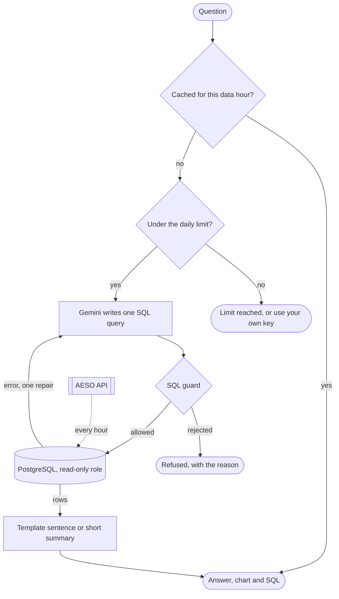

<div align="center">


# Alberta Energy Analyst

**Ask plain-English questions about Alberta's electricity market.<br>Get an answer, a chart, and the exact SQL that produced it.**

[](pyproject.toml)
[](api/main.py)
[](docker-compose.yml)
[](web/package.json)
[](router.py)
[](LICENSE)

[How it works](#how-it-works) · [Quick start](#quick-start) · [SQL guard](#sql-guard) · [Evaluation](#evaluation) · [API](#api)

</div>

The data is the AESO's hourly pool price and Alberta internal load (demand), actual and forecast, from January 2000 to the current hour, kept in PostgreSQL and refreshed every hour. A language model writes one SQL query per question. A guard decides whether that query may run. The result comes back as a short answer, a chart, and the query itself, so anyone can check it.

**Accuracy:** 25 of 30 on a hand-written test set, latest full run ([score history](evals/history.md)) · **Model cost:** $0, on the Gemini free tier

## Highlights

- **Plain English in, SQL out.** A question such as *"Which month of 2025 had the highest average demand?"* becomes one read-only SQL query over every hour since 2000.
- **Shows its work.** Every answer comes with the SQL and the rows it returned.
- **Picks the chart.** One value is shown as a figure, time plus a number as a line chart, a category plus a number as a bar chart, anything else as a table.
- **Refuses instead of guessing.** Questions the data cannot answer (the future, generation by fuel type, a specific customer) get a reason, not a made-up number.
- **Guarded.** The model only proposes SQL. A parser-based [guard](#sql-guard) and a read-only database role decide what runs.
- **Cached and shareable.** A repeated question costs nothing, and every saved answer opens at `/a/{id}`; the example answers on the Info page link there.
- **Free to try.** Visitors get a few free questions a day. Anyone can enter their own Gemini key; it stays in their browser and is sent only with their questions.
- **Always current.** The app pulls new AESO hours every hour. The Info page explains the four parts of the system and shows the latest price and demand and a week of hourly prices, straight from the database.

## How it works



1. **Cache check.** The normalized question plus the latest data hour is hashed. A hit returns the saved answer with no model call.
2. **Rate limit.** A daily count per visitor, keyed on a salted hash of the address. Skipped when the visitor sends their own key.
3. **Prompt.** The table layout, a few glossary rules (filter dates on Alberta local time, half-open ranges, NULL handling), today's date, the data range, and five worked examples that are not in the test set ([`api/prompt.py`](api/prompt.py)).
4. **Model.** The router tries the configured Gemini models in order, with a 15 second timeout and one retry per model, moving on at once when a model is rate limited, the key is bad, or a reply comes back cut off ([`router.py`](router.py)).
5. **Guard.** The SQL is parsed with sqlglot and must be exactly one SELECT on the two market tables, with no writing statement anywhere in it. A row limit is added ([`api/guard.py`](api/guard.py)).
6. **Run.** The query runs as a read-only database role with a 5 second statement timeout, and the result size is capped. If PostgreSQL reports an error, the model gets one repair attempt with the error text.
7. **Answer.** A single value fills a template. Several rows get one or two sentences from a second model call, given 10 seconds at most; past that, a line or bar chart gets a plain highest-and-lowest sentence instead.
8. **Stream.** The page receives server-sent events: `sql`, then `rows`, then `answer`, then `done` (or `error`). A `status` event arrives each time a model call fails and the router tries again, so the page can say which model is busy.
9. **Save and log.** The answer is cached under a short id for sharing, and the question, SQL, provider, latency and outcome are logged.

> [!NOTE]
> The model never touches the database. It only proposes SQL; the guard and the read-only role decide what runs.

## Tech stack

| Layer | Built with |
|---|---|
| Backend | Python 3.12, FastAPI on uvicorn, sqlglot, psycopg 3, httpx |
| Database | PostgreSQL 16 |
| Model | Google Gemini through its REST API, no SDK |
| Frontend | React 19, TypeScript, Vite, Tailwind CSS, hand-drawn SVG charts (no chart library) |
| Tooling | uv, ruff, oxlint, GitHub Actions |

## Quick start

You need Docker, [uv](https://docs.astral.sh/uv/), Node 20.19+ or 22.12+, and two free keys: one from the [AESO API portal](https://developer-apim.aeso.ca/) and one from [Google AI Studio](https://aistudio.google.com/apikey).

```bash
cp .env.example .env      # add the two keys and a random IP_SALT (openssl rand -hex 16)
docker compose up -d db   # PostgreSQL 16 on 127.0.0.1:5432
uv sync
uv run --env-file .env python -m ingest.migrate
uv run --env-file .env python -m ingest.backfill --from 2000-01-01   # about two minutes
cd web && npm ci && npm run build && cd ..
uv run --env-file .env uvicorn api.main:app
```

Open http://localhost:8000. The Info page is at `/`, the Ask page at `/ask`, and one process serves the site and the API. While it runs, the API pulls new AESO hours at start and at 5 past every hour. Live reload, every optional setting, and the precompute and scoring commands are in [docs/running-locally.md](docs/running-locally.md).

## SQL guard

Defence in depth, so one mistake does not expose the database:

1. A read-only database role (`app_readonly`) with SELECT on the two market tables only, `default_transaction_read_only = on`, and a 5 second statement timeout ([`db/002_readonly_user.sql`](db/002_readonly_user.sql)). Its password is set by the migrate command from `DATABASE_URL_READONLY`; none is in the repo.
2. Parsing with sqlglot: exactly one statement, and it must be a SELECT or a set operation.
3. No DML, DDL, COPY, SET, LOCK, SELECT INTO or transaction control anywhere in the tree, CTEs included.
4. A table allowlist: `pool_price` and `system_load`. No system catalogs; CTE names are allowed.
5. A function blocklist: `pg_*`, `lo_*`, `dblink`, `inet_*`, `set_config`, `current_setting`, the XML dump functions, and the server-revealing names such as `version()` and `current_user`.
6. `LIMIT 1000` added or lowered, and a cap on the total size of the result.

<details>
<summary>Tried and rejected</summary>

- `DROP TABLE pool_price`
- `SELECT 1; DELETE FROM pool_price`
- `SELECT pg_sleep(30)`
- `SELECT * FROM pg_user`
- `WITH x AS (DELETE FROM pool_price RETURNING *) SELECT * FROM x`
- `COPY pool_price TO '/tmp/out'`
- `SELECT * FROM pool_price FOR UPDATE`
- `EXPLAIN SELECT 1`
- `SELECT version()`
- a huge cross join, which hits the timeout

</details>

## Model layer

[`router.py`](router.py) is a small, dependency-light router: one interface for providers, retries with backoff, a timeout per call and an optional limit for the whole call, fallback to the next provider on quota, rate-limit or bad-key errors or a cut-off reply, and a notice for every retry. Only a Gemini provider exists today (REST API, key in a header, no SDK). The models tried, in order, come from `GEMINI_MODELS`.

The Gemini free tier allows only a small number of requests a day per model, so the router spreads calls across several model names. Keeping it at $0:

- Cache every answer; repeat questions are free.
- Precompute the example questions (`python -m api.precompute`).
- Rate limit per visitor, and offer bring-your-own-key.
- Use a template instead of a second model call for single-value results.
- Skip the summary call when scoring the test set.

## Evaluation

The test set, [`evals/questions.yaml`](evals/questions.yaml), is written by hand: 30 questions (10 easy, 11 medium, 6 hard, 3 traps), each with gold SQL or, for traps, the outcome that must happen. [`evals/run.py`](evals/run.py) runs the gold SQL and the model's SQL against the same database and compares the rows: order ignored unless the question asks for a ranking, column names ignored, numbers within a small tolerance. Every failure gets a label (wrong filter, wrong shape, wrong values, timezone, refused, guard rejected, timeout, SQL error, empty, provider error). A full run in which every question got a model answer writes `evals/score.json`, which the Info page shows.

Rules: no hard-coded answers (gold SQL runs at test time, so new data never breaks a test); fixed dates in questions; the prompt's examples never come from the test set; change one thing at a time and record the score in [`evals/history.md`](evals/history.md).

## Data

| Source | What it has | Cost |
|---|---|---|
| [AESO public API](https://developer-apim.aeso.ca/) | Pool price (hourly, actual and short-term forecast), Alberta internal load (hourly, actual and 14-day forecast), and more | Free, self-serve key |

Two tables, one row per hour, keyed on the UTC hour beginning. The Alberta local time (`begin_mpt`) repeats one hour each November, so it is indexed but never a key. Questions about days and months filter on it. Details, quirks and the endpoints that were tried are in [docs/aeso-data.md](docs/aeso-data.md); the market terms are in [docs/glossary.md](docs/glossary.md).

The ingestion job ([`ingest/`](ingest/)) pulls a trailing window every hour and upserts it (the API runs it in a background thread while it is up, at start and at 5 past every hour), so revised forecasts are picked up and a re-run never duplicates rows. A year-by-year backfill loads the history from 2000. Every run is logged in `ingestion_runs`. The question path never calls the AESO, so the site keeps working if the AESO API is down.

## API

| Method | Path | Purpose |
|---|---|---|
| `POST` | `/api/ask` | Answer a question. Responds with an SSE stream. |
| `GET` | `/api/site` | What the pages show at load: the market now, the example answers, the test-set score, the daily limit. |
| `GET` | `/api/a/{id}` | A saved answer, for shareable links. |
| `GET` | `/api/health` | Health check. |

When `web/dist` exists, the same process serves the built site at `/`, `/ask` and `/a/{id}`.

<details>
<summary>The <code>/api/ask</code> stream</summary>

```
event: sql
data: {"sql": "SELECT count(*) FROM pool_price WHERE ..."}

event: rows
data: {"columns": ["count"], "rows": [[37]], "chart": "stat"}

event: answer
data: {"text": "count: 37", "cached": false}

event: done
data: {"id": "8f3k2x", "provider": "gemini:gemini-3.8-flash", "latency_ms": 2140}
```

While a model is retried:

```
event: status
data: {"message": "gemini-3.8-flash did not answer (HTTP 503), trying gemini-3.5-flash"}
```

Errors arrive as `event: error` with a `reason` of `rate_limited`, `rejected`, `timeout`, `empty`, `provider_unavailable`, `database_unavailable` or `server_error`.

</details>

## Project structure

```
api/          FastAPI app, prompt, SQL guard, read-only runner, cache and logs
router.py     model router: providers, retries, fallback
ingest/       AESO client, migrations, backfill, hourly job
evals/        questions.yaml, harness, score history
db/           SQL migrations
web/          React site (Vite, TypeScript, Tailwind), no chart library
docs/         data notes, glossary, how to run it
Dockerfile    one image: builds the site, runs the API that serves it
.env.example  the variables to set; copy it to .env
```

## Development

No automated tests, by decision: changes are checked by running them and reading the result. CI runs the same checks as these on pushes to `main` and on pull requests:

```bash
uv run ruff check . && uv run ruff format --check .
cd web && npm run lint && npm run build
```

## Privacy

- Questions are sent to Google's Gemini API, which writes the SQL. On Gemini's free tier, Google may use what it receives to improve its products and human reviewers may read it, so don't put personal information in a question.
- Visitor questions and the SQL that answered them are logged in `query_log`, so bad answers can become new test cases.
- Visitor addresses are stored only as salted hashes, and only for the current day's rate limit.
- A visitor's own Gemini key is kept in their browser, sent only with their questions, and never stored or logged by the server.

## Limits and known gaps

- Free-tier model quotas are small, so the site leans on the cache, the precomputed examples, the daily visitor limit and bring-your-own-key.
- The data has only price and total demand. Generation by fuel type and per-customer data are not in the API's history, so questions about them are refused.
- Table-valued functions such as `generate_series` are rejected by the guard.
- The AESO's [terms](https://www.aeso.ca/legal) allow non-commercial, personal or educational use and do not address public display; check them before hosting this for others.

## Credits

Market data from the [AESO](https://www.aeso.ca/). Photos from Pexels under the Pexels licence, listed in [web/src/assets/photos/CREDITS.md](web/src/assets/photos/CREDITS.md). Built with FastAPI, sqlglot, psycopg, React, Vite and Tailwind.

## License

The code is under the [MIT License](LICENSE). The AESO data and the photos are not covered by it; they keep their own terms (see [Credits](#credits)).
